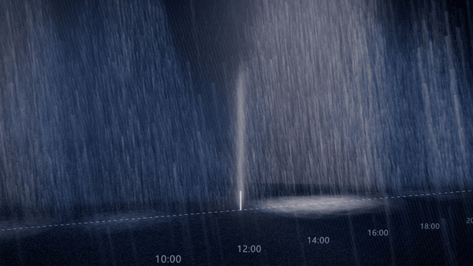
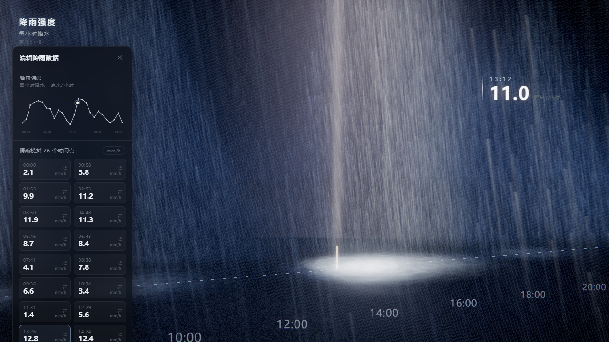

# 如果降雨数据变成雨 · When Rainfall Data Becomes Rain

> 把一天的降雨数据变成一场真实的雨 —— Three.js + WebGL + 自定义 GLSL Shader 实时粒子雨景。

**▶ 在线体验：[yanx5433-cmd.github.io/rain-as-data](https://yanx5433-cmd.github.io/rain-as-data/)**（建议屏幕调亮）





一次对「数据可视化 × 粒子特效」的实验：26 个降雨观测点被摆放成一条时间轴上的雨柱，
每一根柱子就是那个时刻的雨 —— 雨量越大，雨柱越高、越密、越亮。时间游标缓缓走过一天，
右上角实时显示当前时刻的降雨强度。

## ✨ 特性

- 🌧️ **GLSL 粒子雨**：约 3 万条雨丝由自定义顶点着色器驱动，高度 / 密度 / 亮度与数据值联动
- 💦 **溅落与光斑**：地面飞溅粒子 + 雨量光斑，配合 UnrealBloom 后期泛光
- ⏱️ **一天回放**：播放头沿 00:00 → 24:00 推进，同步驱动 3D 高亮、HUD 读数、折线图标记与表格高亮
- 🎥 **电影式运镜**：Catmull-Rom 相机路径自动巡航，随手拖拽可自由旋转视角，松手 5 秒后平滑回归
- 📊 **数据面板**：毛玻璃质感面板，含降雨强度折线图与 26 个时间点数据表，可收起
- ⚡ **零构建、全本地**：无打包器、无外部请求（Three.js 已本地化），克隆即用

## 🚀 运行

```bash
# 任意静态服务器指向本目录即可，例如
python -m http.server 8642
# 然后打开
# http://127.0.0.1:8642/index.html
```

Windows 用户可直接双击 `启动雨景.bat`。

> 需要支持 ES Modules 与 Import Map 的现代浏览器（Chrome 89+ / Edge 89+ / Safari 16.4+ / Firefox 108+）。

## 🛠️ 技术栈

| 模块 | 实现 |
| --- | --- |
| 渲染 | Three.js r160 + EffectComposer + UnrealBloomPass |
| 雨丝 | `LineSegments` + 自定义顶点着色器（时间循环下落 / 播放头邻域增亮） |
| 溅落 | `Points` + 自定义着色器（正弦跳动 + 距离衰减） |
| 光斑 | `Points` + 径向渐变纹理，亮度 ∝ 雨量^1.7 |
| UI | 原生 HTML/CSS（毛玻璃面板、SVG 折线图） |

## 📂 结构

```
rain-viz/
├── index.html        # 页面骨架 / HUD / 数据面板
├── main.js           # 场景、着色器、运镜、回放逻辑
├── style.css         # 界面样式
├── lib/              # 本地化的 Three.js 及插件（离线可用）
└── 启动雨景.bat       # Windows 一键启动
```

## 🎨 修改数据

编辑 `main.js` 顶部的 `values` 数组（26 个毫米/小时数值）即可换上你自己的降雨数据；
时间点会自动均匀铺满 00:00 – 24:00。

## 🙏 灵感来源

灵感来自抖音博主 **@afterimage** 的作品《如果降雨数据变成雨，大概是这样》
（[原视频](https://www.douyin.com/video/7665305181642312966)），本项目是依照其视觉效果的
Three.js 复刻与再实现，向原作者致谢。

## 📄 License

[MIT](LICENSE)
